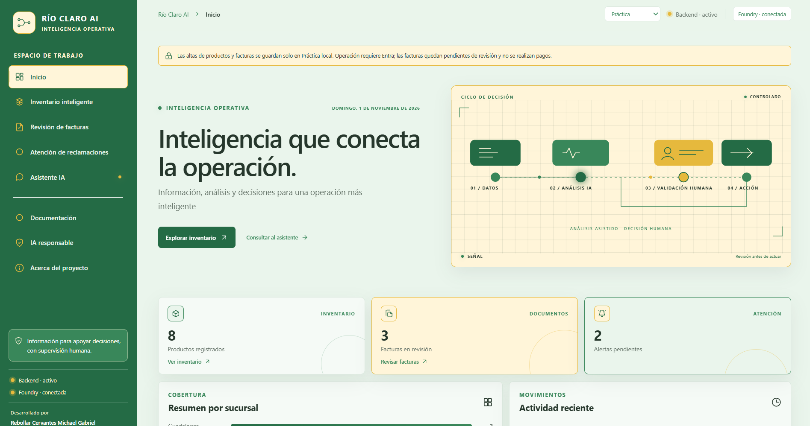
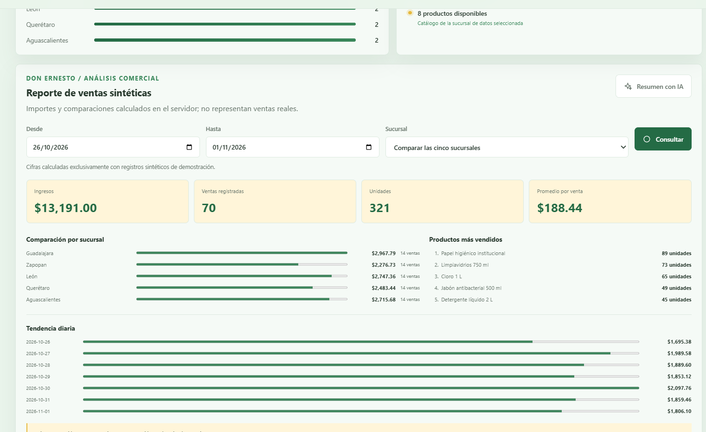
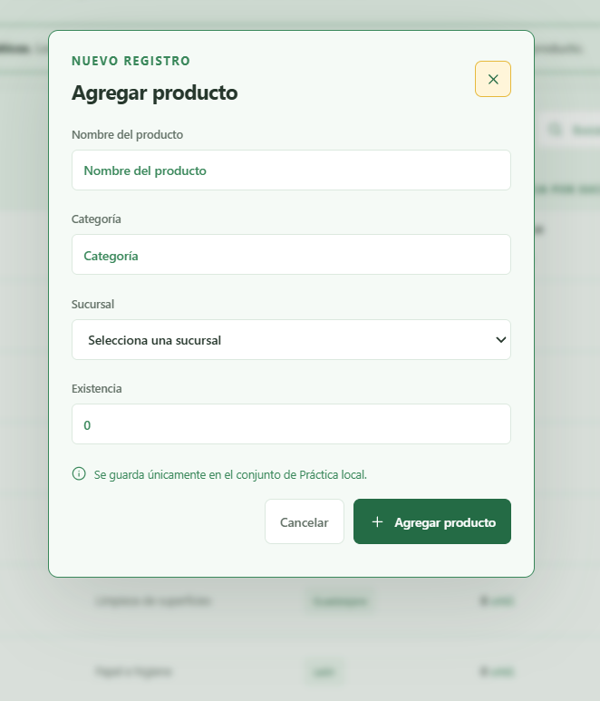
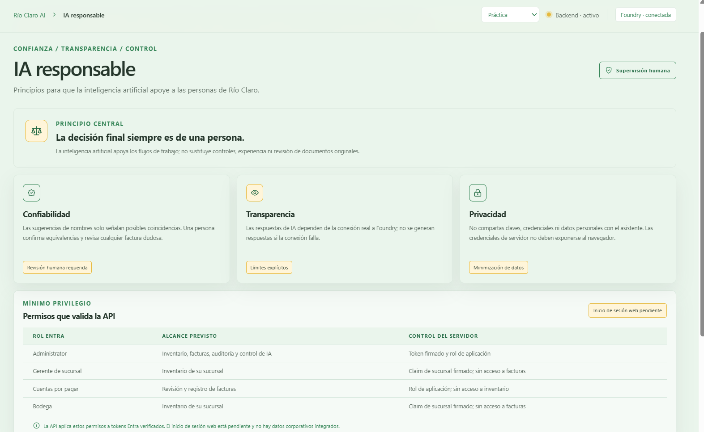
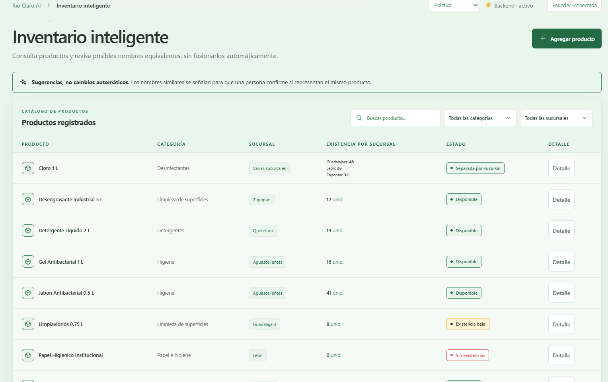
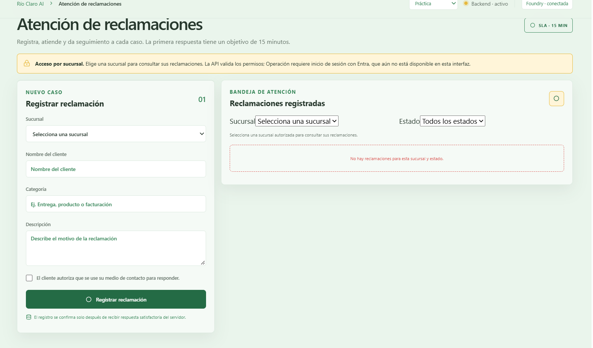
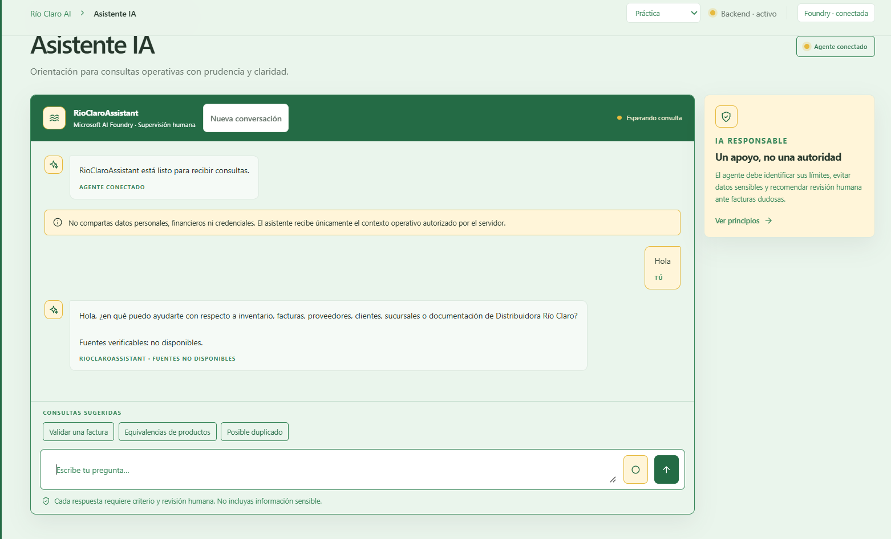
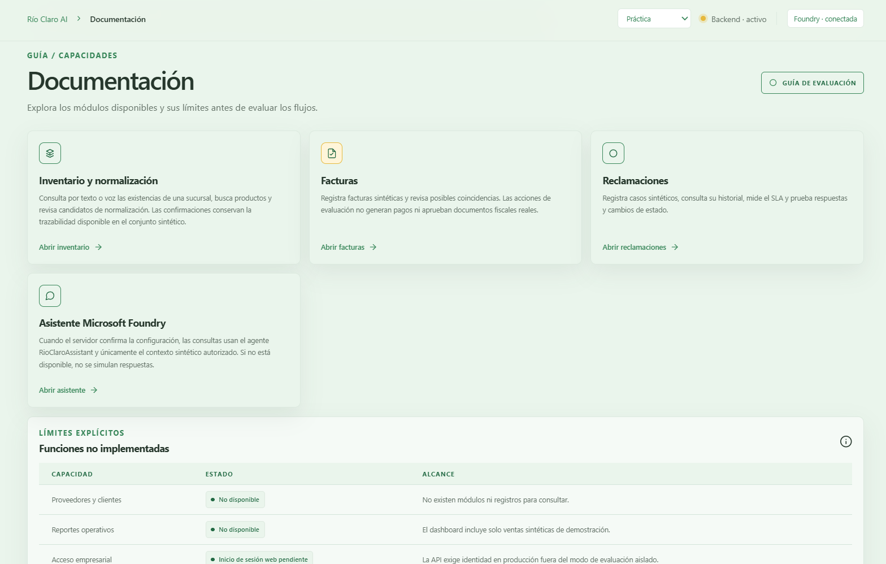
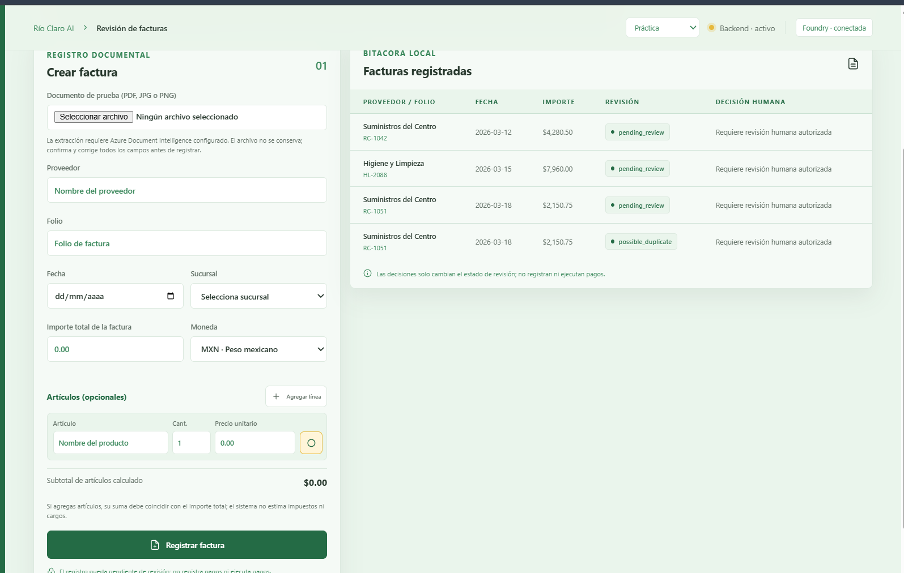
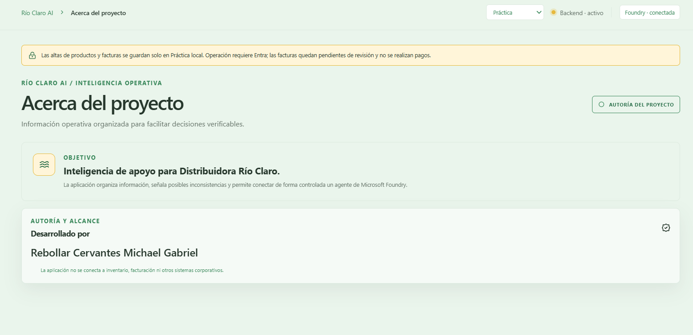

# RÍO CLARO AI

**Plataforma de inteligencia operativa para la gestión de inventario, revisión de facturas, reclamaciones y asistencia empresarial mediante Microsoft Foundry.**

Demostración pública de una arquitectura basada en Node.js, Microsoft Azure e inteligencia artificial, diseñada para facilitar la gestión y el análisis de información empresarial.

---

---

# EXPERIENCIA VISUAL

Descubre los módulos, herramientas y funcionalidades de **RÍO CLARO AI**.

## 01 — Página principal

<p align="center">
  
</p>

## 02 — Experiencia completa

<p align="center">
  
</p>

## 03 — Gestión de inventario

<p align="center">
  
</p>

## 04 — Registro de productos

<p align="center">
  
</p>

## 05 — Gestión de reclamaciones

<p align="center">
  
</p>

## 06 — Gestión de facturas

<p align="center">
  
</p>

## 07 — Documentación

<p align="center">
  
</p>

## 08 — Asistente de inteligencia artificial

<p align="center">
  
</p>

## 09 — Inteligencia artificial responsable

<p align="center">
  
</p>

## 10 — Acerca del proyecto

<p align="center">
  
</p>

---

<p align="center">
  <strong>RÍO CLARO AI</strong><br>
  Inteligencia operativa · Gestión empresarial · Microsoft Foundry
</p>
## Alcance y arquitectura

- **Frontend:** aplicación web estática en `public/`, con diseño adaptable a escritorio y móvil.
- **API:** Node.js 24 y Express en `server.js` y `server/app.js`.
- **Datos:** archivos JSON con persistencia atómica. El modo de demostración utiliza archivos propios, separados de los datos operativos.
- **Identidad:** Microsoft Entra ID verifica las solicitudes operativas. Las solicitudes públicas de demostración no requieren cuenta y quedan fijadas en el origen sintético.
- **Asistente:** el backend usa `@azure/ai-projects` y `DefaultAzureCredential` para invocar el agente existente mediante la identidad administrada. No hay respuestas simuladas en producción.
- **Servicios opcionales:** Key Vault para cargar secretos del backend y Azure AI Document Intelligence para extraer campos de facturas. Document Intelligence no es necesario para la demostración pública.

La aplicación incluye un conjunto controlado de productos y facturas de ejemplo, y reportes de ventas generados y etiquetados como sintéticos. No son datos de la empresa. Las escrituras públicas de demostración no consultan ni modifican registros operativos.

## Requisitos

- Node.js 24 (Node.js 22 o superior es compatible con los SDK instalados).
- npm incluido con Node.js.
- Para comprobar Foundry localmente: acceso de red al proyecto y una credencial Azure de desarrollo con los permisos necesarios. Los visitantes no necesitan una cuenta Microsoft.

## Instalación y ejecución local

```powershell
npm ci
```

Para no utilizar ningún archivo de datos local preexistente, configura el modo sintético con archivos aislados en una carpeta temporal:

```powershell
$demoDir = Join-Path $env:TEMP 'rioclaro-public-demo'
New-Item -ItemType Directory -Force $demoDir | Out-Null
$env:NODE_ENV = 'development'
$env:RIOCLARO_EVALUATION_MODE = 'true'
$env:RIOCLARO_DATA_FILE = Join-Path $demoDir 'data.json'
$env:RIOCLARO_EVALUATION_DATA_FILE = $env:RIOCLARO_DATA_FILE
$env:RIOCLARO_AUDIT_FILE = Join-Path $demoDir 'audit.json'
$env:RIOCLARO_EVALUATION_AUDIT_FILE = $env:RIOCLARO_AUDIT_FILE
$env:FOUNDRY_CONVERSATIONS_FILE = Join-Path $demoDir 'conversations.json'
$env:RIOCLARO_EVALUATION_CONVERSATIONS_FILE = $env:FOUNDRY_CONVERSATIONS_FILE
$env:FOUNDRY_ENABLED = 'false'
npm start
```

Abre `http://localhost:3000`. Si `PORT` está definido, el servidor escucha en ese puerto. Foundry queda desactivado en el ejemplo local; el chat indica que no está disponible hasta que el servicio esté configurado y verificado.

Para habilitar Foundry localmente, establece las variables de Foundry de la tabla siguiente y autentícate con un proveedor admitido por `DefaultAzureCredential` (por ejemplo, `az login`). No pegues tokens ni secretos en el repositorio, en el navegador o en mensajes.

## Variables de entorno

Los valores de ejemplo están en [.env.example](./.env.example). Nunca guardes valores secretos en ese archivo.

### Azure App Service: requeridas para la demostración pública

| Variable | Valor |
|---|---|
| `NODE_ENV` | `production` |
| `RIOCLARO_EVALUATION_MODE` | `true` |
| `RIOCLARO_DATA_FILE` y `RIOCLARO_EVALUATION_DATA_FILE` | Ambas `/home/data/rioclaro-public-demo/data.json` |
| `RIOCLARO_AUDIT_FILE` y `RIOCLARO_EVALUATION_AUDIT_FILE` | Ambas `/home/data/rioclaro-public-demo/audit.json` |
| `FOUNDRY_CONVERSATIONS_FILE` y `RIOCLARO_EVALUATION_CONVERSATIONS_FILE` | Ambas `/home/data/rioclaro-public-demo/conversations.json` |

Las tres rutas deben ser absolutas, distintas entre sí y estar en almacenamiento persistente. El servidor rechazará rutas que coincidan con los archivos operativos predeterminados o entre sí. No reutilices un archivo operativo para la demostración.

`PORT` lo proporciona App Service; no fijes un puerto de producción. En **Configuración > Pila de configuración**, selecciona Node 24 y usa `npm start`.

### Microsoft Foundry: requeridas para habilitar el asistente

| Variable | Valor |
|---|---|
| `FOUNDRY_PROJECT_ENDPOINT` | `https://rioclaroia-resource.services.ai.azure.com/api/projects/rioclaroia` |
| `FOUNDRY_AGENT_NAME` | `RioClaroAssistant` |
| `FOUNDRY_ENABLED` | `true` |
| `FOUNDRY_SUSPENDED` | `false` |

Activa la **identidad administrada** del App Service. Para el recurso/proyecto Foundry indicado, concede a esa identidad el rol mínimo que permita consultar el agente y ejecutar respuestas. La comprobación de conexión usa `project.agents.get`; si el rol de consumidor no autoriza esa lectura en la configuración del proyecto, revisa el rol **Foundry User** con el menor ámbito posible. Confirma los permisos efectivos en Azure; el código no puede concederlos. La identidad se usa exclusivamente desde el backend.

No se necesita una clave de Foundry ni autenticación Microsoft para los visitantes. `AZURE_CLIENT_ID` solo se configura si se selecciona una identidad administrada asignada por el usuario; para una identidad asignada por el sistema, déjala vacía. `FOUNDRY_TIMEOUT_MS` es opcional; su valor predeterminado es `20000` y el rango permitido es de 1000 a 120000 ms.

### Variables opcionales o solo para otros escenarios

| Variable | Cuándo se usa |
|---|---|
| `KEY_VAULT_URL` y `KEY_VAULT_SECRET_NAMES` | Solo si el backend debe leer secretos `FOUNDRY_*` desde Key Vault. Configura ambos y asigna a la identidad el rol **Key Vault Secrets User**. No son necesarios para autenticarse a Foundry mediante identidad administrada. |
| `DOCUMENT_INTELLIGENCE_ENDPOINT` | Solo si se habilita extracción de facturas en un entorno autorizado. No es requisito para la demostración pública, donde se bloquea el análisis de documentos externos. |
| `CORS_ALLOWED_ORIGINS` | Solo para clientes web en otros orígenes. Para la aplicación servida desde el mismo App Service, déjala vacía. |
| `ENTRA_TENANT_ID`, `ENTRA_API_CLIENT_ID`, `ENTRA_BRANCH_CLAIM` | Solo para la API operativa protegida con Entra. No se necesitan para el modo público de demostración. |
| `RIOCLARO_OPERATIONAL_DATA_FILE`, `RIOCLARO_OPERATIONAL_AUDIT_FILE`, `RIOCLARO_OPERATIONAL_CONVERSATIONS_FILE` | Solo para declarar rutas operativas explícitas que el arranque debe proteger frente a una configuración de demostración coincidente. No apuntes la demostración a esos archivos. |
| `ALLOW_UNAUTHENTICATED_LOCAL_CHAT` | Exclusivamente para pruebas locales; nunca lo actives en producción. |
| `AZURE_KEY_VAULT_ACCESS_TOKEN` | Credencial de desarrollo local heredada para Key Vault; no la configures en Azure ni la publiques. En Azure se usa identidad administrada. |

Key Vault no es obligatorio si los valores no secretos de Foundry se configuran como ajustes del App Service. No configures un almacén ni publiques credenciales solo para habilitar Foundry.

## Seguridad, persistencia y límites

- El modo público solo atiende el origen `practice`, incluso si el visitante envía una cabecera que solicita datos operativos.
- El modo de demostración debe ejecutarse en una instancia aislada; la aplicación rechaza rutas de persistencia que se solapen con las rutas operativas predeterminadas.
- Las ediciones públicas solo modifican nombre, categoría y sucursal. No cambian existencias. Cambiar la sucursal se bloquea si existen movimientos o referencias de factura; productos agrupados o pendientes de revisión no se editan automáticamente.
- Las eliminaciones requieren confirmación en la interfaz y se bloquean si afectan movimientos o referencias protegidas. Las altas, ediciones, eliminaciones y denegaciones relevantes se auditan.
- Se mantienen validación del servidor, límites de tamaño y tasa, cabeceras de seguridad, aislamiento de roles y controles de datos sensibles.
- Los datos JSON bajo `/home` sobreviven reinicios de App Service cuando el almacenamiento persistente está habilitado. Con la persistencia local actual, mantén una sola instancia de escritura; no escales horizontalmente sin migrar a un almacén con coordinación de concurrencia.
- No se modifican ni limpian desde este repositorio archivos de datos persistentes o recursos de Azure.

## Pruebas y verificación

```powershell
npm test
node --check server.js
node --check server\app.js
node --check server\data\store.js
node --check server\services\foundry.js
node --check public\app.js
git diff --check
```

El test de integración de Foundry está separado de la suite local. Requiere credenciales, permisos y `FOUNDRY_INTEGRATION_TEST=true`; no se considera aprobado si se omite.

Para ejecutarlo localmente, configura el endpoint, agente, `FOUNDRY_ENABLED=true` y la credencial Azure de desarrollo, y luego ejecuta:

```powershell
$env:FOUNDRY_INTEGRATION_TEST = 'true'
npm run test:foundry
```

La integración envía consultas al agente real; no la ejecutes contra un recurso que no tengas autorización para usar.

Después de configurar Azure, verifica:

1. `GET /health`: `status` debe ser `ok`, `evaluationMode` debe ser `true` y la disponibilidad de Foundry debe corresponder al último chequeo real.
2. `GET /api/security/status`: confirma el modo de evaluación, sin necesidad de credenciales de visitante.
3. `GET /api/products`: debe devolver `200` y `origin: "practice"` sin token.
4. `POST /api/foundry/check`: debe devolver `connected: true` solo si el backend pudo consultar el agente con su identidad administrada.
5. Envía una consulta desde el chat y comprueba que la respuesta del agente llega a la interfaz. Si el chequeo falla, consulta los registros del App Service y revisa endpoint, nombre del agente, identidad y RBAC.

La ruta de comprobación es `POST`, está limitada por tasa y no devuelve secretos. Un chequeo HTTP exitoso por sí solo no implica conexión: comprueba también `connected`.

## Publicación en el App Service existente

El workflow [.github/workflows/deploy-azure.yml](./.github/workflows/deploy-azure.yml) solo tiene `workflow_dispatch`; no se ejecuta en cada push. Despliega únicamente a `rioclaro-ai-mgrc`, después de instalar dependencias, ejecutar `npm test` y preparar el paquete de producción.

Antes de ejecutarlo:

1. Configura el runtime Linux Node 24, `npm start`, almacenamiento y variables de App Service descritas arriba.
2. Habilita la identidad administrada existente y verifica los permisos de Foundry. No crees otro App Service ni recursos adicionales para este despliegue.
3. Añade el secreto de repositorio `AZURE_WEBAPP_PUBLISH_PROFILE` en GitHub. No pegues ni envíes el perfil de publicación; trátalo como credencial de despliegue.
4. Ejecuta las pruebas localmente y revisa todos los cambios.
5. Tras autorizar la publicación, publica los cambios al branch configurado y ejecuta **Actions > Deploy existing Azure App Service > Run workflow**. No ejecutes el workflow hasta contar con autorización explícita.

El workflow no configura ni reemplaza los ajustes del App Service. Después de un despliegue autorizado, repite las verificaciones anteriores. El endpoint público observado antes de publicar los cambios no sirve como prueba de que esta versión ya esté desplegada o que Foundry esté conectado.

Como comprobación posterior, el workflow espera a que la aplicación responda, exige el modo público de evaluación, consulta productos sin autenticación y comprueba la conexión real de Foundry. No envía una conversación de prueba ni crea datos de chat persistentes. Para verificar también una respuesta real, después del workflow envía una consulta sintética desde el asistente de la interfaz.